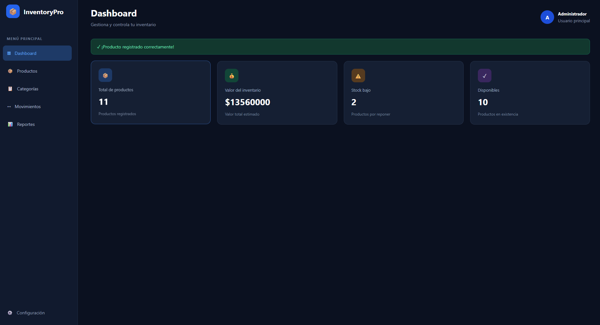
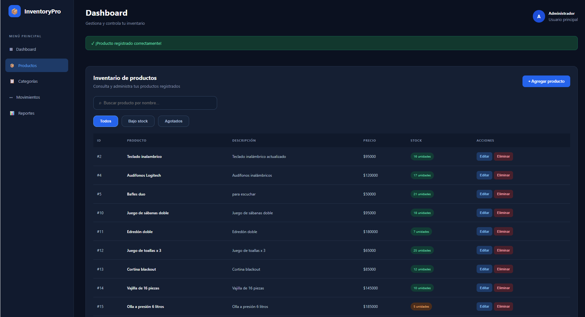
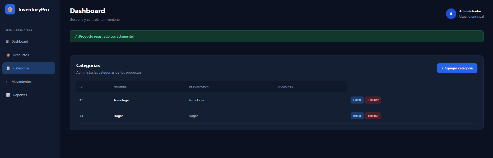
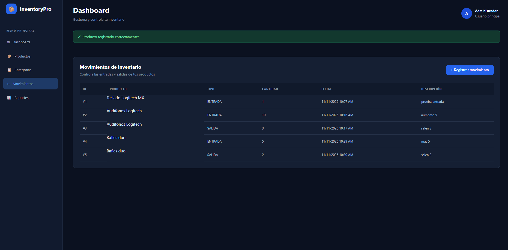
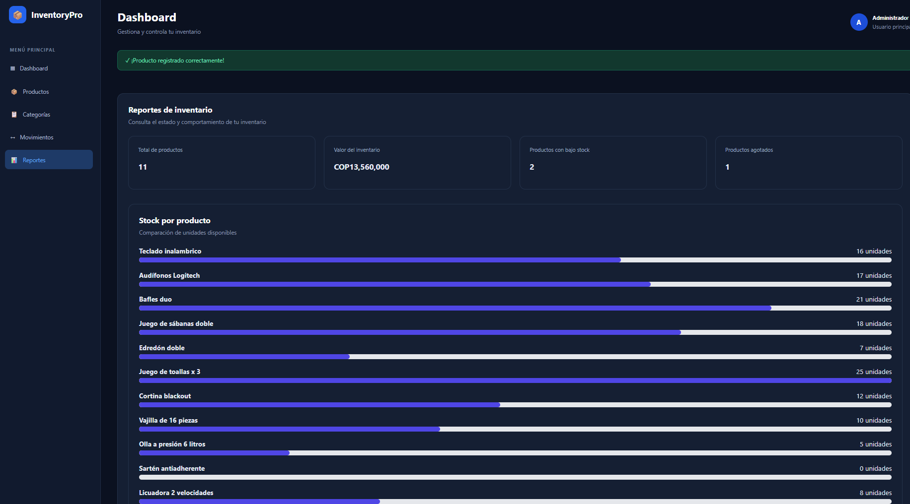

# InventoryPro – Sistema de Gestión de Inventario

Aplicación web full stack desarrollada para administrar inventarios de manera sencilla y organizada. Permite gestionar productos, categorías, movimientos de entrada y salida, y consultar reportes sobre las existencias.

## Tecnologías utilizadas

**Backend**
- Java 21
- Spring Boot
- Spring Data JPA
- Hibernate
- Maven

**Frontend**
- Angular
- TypeScript
- HTML
- CSS

**Base de datos**
- MySQL

## Funcionalidades

- Registro, consulta, edición y eliminación de productos.
- Creación, edición y eliminación de categorías.
- Registro de movimientos de entrada y salida.
- Actualización automática de existencias.
- Validación para evitar salidas superiores al stock disponible.
- Búsqueda y filtrado de productos.
- Dashboard con indicadores del inventario.
- Reportes del valor total del inventario.
- Identificación de productos con stock bajo y agotados.
- Gráfico de existencias por producto.

## Arquitectura del proyecto

El proyecto está organizado en dos módulos principales:

**Backend**
API REST desarrollada con Spring Boot, organizada en capas:
- Controllers
- Services
- Repositories
- Entities
- DTOs
- Exception handling

**Frontend**

Aplicación desarrollada con Angular, encargada de la interfaz de usuario y de consumir los servicios REST del backend.

**Base de datos**

MySQL para almacenar la información de productos, categorías y movimientos.

## Capturas de pantalla

### Dashboard


### Productos


### Categorías


### Movimientos


### Reportes


## Ejecución local

### Requisitos
- Java 21
- Node.js y npm
- Angular CLI
- MySQL

### Backend

1. Crear la base de datos `inventory_management_db` en MySQL.
2. Configurar la variable de entorno `DB_PASSWORD` con la contraseña del usuario de MySQL.
3. Desde la carpeta `backend`, ejecutar:

```powershell
.\mvnw.cmd spring-boot:run
```

Backend disponible en `http://localhost:8080`.

### Frontend

Desde la carpeta `frontend`, ejecutar:

```bash
npm install
ng serve
```

Frontend disponible en `http://localhost:4200`.

### Pruebas

Para ejecutar las pruebas del backend, desde la carpeta `backend`:

```powershell
.\mvnw.cmd test
```

## Estado del proyecto

Proyecto desarrollado como práctica de desarrollo de software full stack, aplicando conceptos de programación orientada a objetos, arquitectura por capas, API REST, persistencia de datos y desarrollo frontend.